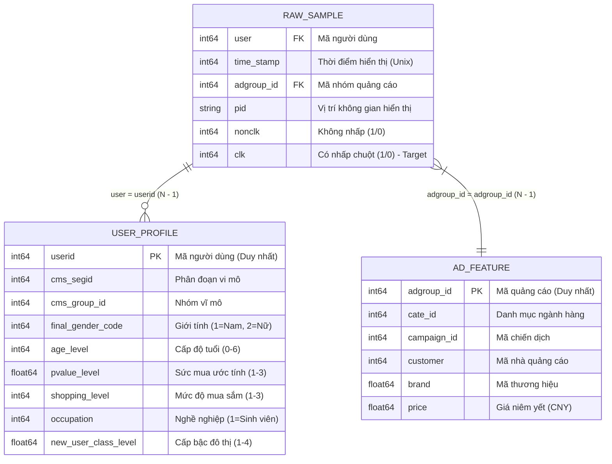

# BỘ DỮ LIỆU TAOBAO DISPLAY ADVERTISING & THIẾT KẾ CÁC BÀI TOÁN DỰ ĐOÁN CTR (CLICK-THROUGH RATE)

---

## 1. TỔNG QUAN VỀ BỘ DỮ LIỆU TAOBAO ADVERTISING CTR

Bộ dữ liệu **Taobao Display Advertising Click-Through Rate Dataset** là tập dữ liệu quy mô lớn do **Alibaba Group (Taobao)** công bố. Đây là bộ dữ liệu benchmark kinh điển trong ngành khoa học dữ liệu và trí tuệ nhân tạo, đặc biệt được sử dụng làm chuẩn mực đánh giá cho các kiến trúc mạng nơ-ron sâu trong hệ thống gợi ý và quảng cáo trực tuyến như **DIN (Deep Interest Network)**, **DIEN (Deep Interest Evolution Network)**, **DeepFM**, **Wide & Deep**,...

* **Nguồn gốc:** Alibaba Tianchi / Taobao Display Ad System.
* **Thời gian thu thập:** **8 ngày liên tục**, từ `06/05/2017 00:00:00` đến `13/05/2017 23:59:46` (Giờ Bắc Kinh - UTC+8).
* **Định dạng lưu trữ:** Bảng dữ liệu phân tách bởi dấu phẩy (CSV - Comma-Separated Values), bảng mã chuẩn UTF-8.
* **Quy mô tổng thể:**
  * **26.557.961** lượt hiển thị quảng cáo (impressions).
  * **1.366.056** lượt nhấp chuột hợp lệ (clicks), tương ứng tỷ lệ nhấp chuột trung bình **CTR = 5.1437%**.
  * **1.141.729** người dùng duy nhất phát sinh tương tác.
  * **1.061.768** hồ sơ đặc trưng nhân khẩu học người dùng (`user_profile.csv`).
  * **846.811** mẫu quảng cáo duy nhất (`ad_feature.csv`).
  * **6.769** danh mục ngành hàng và **99.814** thương hiệu khác nhau.

---

## 2. CẤU TRÚC THƯ MỤC & CÔNG CỤ PHÂN TÍCH

Hệ thống được tổ chức khoa học thành 2 thư mục chính: dữ liệu thô và các mã nguồn phân tích/tổng hợp dữ liệu:

```
Meituan/
├── README_Meituan.md              # Tài liệu bộ dữ liệu giao đồ ăn Meituan TRD
├── README_taobao.md               # [TÀI LIỆU NÀY] Cấu trúc chi tiết bộ dữ liệu Taobao CTR
│
├── taobao_data/                   # Thư mục chứa 3 tệp dữ liệu gốc từ Taobao
│   ├── raw_sample.csv             # 1.062,98 MB (26.557.961 dòng - Nhật ký tương tác & nhãn CTR)
│   ├── ad_feature.csv             #    30,64 MB (846.811 dòng - Thuộc tính mẫu quảng cáo)
│   └── user_profile.csv           #    23,95 MB (1.061.768 dòng - Hồ sơ nhân khẩu học người dùng)
│
└── taobao_analysis/               # Thư mục mã nguồn xử lý và phân tích dữ liệu
    ├── analyze_ad_feature.py      # Script phân tích chuyên sâu đặc trưng quảng cáo & giá cả
    ├── analyze_user_profile.py    # Script phân tích nhân khẩu học, độ tuổi, sức mua người dùng
    ├── analyze_raw_sample.py      # Script đọc stream phân đoạn (chunked) tệp lớn raw_sample.csv
    ├── pipeline_summary.py        # Pipeline xuất báo cáo siêu dữ liệu tổng hợp
    └── taobao_summary.json        # Tệp JSON lưu trữ toàn bộ chỉ số thống kê tổng hợp tự động
```

---

## 3. GIẢI NGHĨA CHI TIẾT CẤU TRÚC TỪNG BẢNG DỮ LIỆU

### 3.1. Bảng nhật ký tương tác hiển thị & Click (`raw_sample.csv`)
* **Dung lượng:** 1.062,98 MB (~1,06 GB).
* **Tổng số dòng:** **26.557.961 dòng** (mỗi dòng tương ứng với một lần mẫu quảng cáo được hiển thị trước mắt người dùng).
* **Khóa chính logic:** Tổ hợp `(user, adgroup_id, time_stamp)`.

| Tên trường (Cột) | Kiểu dữ liệu | Ý nghĩa nghiệp vụ | Phân bố & Ví dụ thực tế | Tỷ lệ Null |
| :--- | :--- | :--- | :--- | :--- |
| `user` | Số nguyên (int64) | **Mã định danh người dùng** xem quảng cáo. Khóa ngoại liên kết sang bảng `user_profile.csv(userid)`. | 1.141.729 người dùng duy nhất.<br>Ví dụ: `581738`, `449818` | 0% |
| `time_stamp` | Số nguyên (int64) | **Mốc thời gian hiển thị quảng cáo** dạng Unix Epoch (tính bằng giây). | Khoảng giá trị: `1494000000` đến `1494691186`<br>(Từ `06/05/2017 00:00:00` đến `13/05/2017 23:59:46` UTC+8) | 0% |
| `adgroup_id` | Số nguyên (int64) | **Mã định danh nhóm quảng cáo** được hiển thị. Khóa ngoại liên kết sang bảng `ad_feature.csv(adgroup_id)`. | 846.811 mẫu quảng cáo duy nhất.<br>Ví dụ: `1`, `3`, `4`, `63133` | 0% |
| `pid` | Chuỗi ký tự (string) | **Mã vị trí / Bối cảnh không gian hiển thị** trên giao diện ứng dụng Taobao (Placement ID / Ad Slot Scenario). | Gồm 2 vị trí hiển thị chính:<br>• `430548_1007`: 16.472.898 lượt (62,03%)<br>• `430539_1007`: 10.085.063 lượt (37,97%) | 0% |
| `nonclk` | Số nguyên (0 hoặc 1) | **Chỉ dấu không nhấp chuột** (Non-click Flag). Có giá trị `1` nếu người dùng chỉ nhìn thấy nhưng **không click**; nhận giá trị `0` nếu người dùng có click. | • `1`: 25.191.905 lượt (94,86%)<br>• `0`: 1.366.056 lượt (5,14%) | 0% |
| `clk` | Số nguyên (0 hoặc 1) | **Nhãn mục tiêu dự đoán (Ground Truth Label)**. Có giá trị `1` nếu người dùng **nhấp chuột vào quảng cáo**; nhận giá trị `0` nếu không nhấp. | • `1`: 1.366.056 lượt (5,14%)<br>• `0`: 25.191.905 lượt (94,86%)<br>Tỷ lệ CTR trung bình: **5.1437%** | 0% |

> [!NOTE]
> Hai cột `clk` và `nonclk` luôn có mối quan hệ nghịch đảo bù trừ: `clk + nonclk = 1` trên mọi dòng dữ liệu. Khi huấn luyện mô hình dự đoán CTR, cột `clk` đóng vai trò là nhãn nhị phân đích (`y`).

---

### 3.2. Bảng đặc trưng mẫu quảng cáo (`ad_feature.csv`)
* **Dung lượng:** 30,64 MB.
* **Tổng số dòng:** **846.811 dòng** (mỗi dòng đại diện cho một nhóm quảng cáo / mặt hàng đăng quảng cáo duy nhất).
* **Khóa chính:** `adgroup_id`.

| Tên trường (Cột) | Kiểu dữ liệu | Ý nghĩa nghiệp vụ | Phân bố & Thống kê giá trị | Tỷ lệ Null |
| :--- | :--- | :--- | :--- | :--- |
| `adgroup_id` | Số nguyên (int64) | **Mã định danh duy nhất của mẫu quảng cáo** (Khóa chính). | 846.811 giá trị duy nhất (tương ứng 100% mẫu quảng cáo xuất hiện trong tập nhật ký). | 0% |
| `cate_id` | Số nguyên (int64) | **Mã danh mục ngành hàng** mà sản phẩm quảng cáo thuộc về (Category ID). | 6.769 danh mục duy nhất.<br>Top 1: Danh mục `4505` (34.020 ads), danh mục `6406` (22.257 ads). | 0% |
| `campaign_id` | Số nguyên (int64) | **Mã chiến dịch tiếp thị** (Campaign ID). Một chiến dịch có thể chứa nhiều nhóm quảng cáo `adgroup_id`. | 423.436 chiến dịch duy nhất. | 0% |
| `customer` | Số nguyên (int64) | **Mã nhà quảng cáo / Nhà bán hàng / Chủ shop** trên Taobao sở hữu quảng cáo này (Advertiser ID). | 255.875 chủ sở hữu duy nhất.<br>Nhà quảng cáo lớn nhất sở hữu hơn 1.800 mẫu quảng cáo. | 0% |
| `brand` | Số thực / Chuỗi mã hóa (float64) | **Mã định danh thương hiệu** của sản phẩm (Brand ID). | 99.814 thương hiệu duy nhất.<br>Có 246.330 dòng để trống do sản phẩm thuộc thương hiệu nhỏ lẻ hoặc xưởng gia công nội địa không đăng ký nhãn hiệu. | **29,09%** (246.330 dòng thiếu) |
| `price` | Số thực (float64) | **Giá bán niêm yết của sản phẩm** xuất hiện trong quảng cáo (đơn vị: Nhân dân tệ - CNY). | • Nhỏ nhất (Min): 0.01 CNY<br>• Trung vị (Median): 139.00 CNY<br>• Phân vị 75%: 352.00 CNY<br>• Phân vị 99%: 4.999.00 CNY<br>• Trung bình: 1.838,87 CNY<br>• Lớn nhất (Max): 99.999.999 CNY (mặt hàng đặc biệt/giá ảo) | 0% |

---

### 3.3. Bảng hồ sơ nhân khẩu học người dùng (`user_profile.csv`)
* **Dung lượng:** 23,95 MB.
* **Tổng số dòng:** **1.061.768 dòng** (mỗi dòng tương ứng hồ sơ thông tin của một người dùng Taobao duy nhất).
* **Khóa chính:** `userid`.

> [!WARNING]
> Trong tệp CSV gốc `user_profile.csv`, tên cột cuối cùng có chứa một ký tự khoảng trắng thừa: `'new_user_class_level '`. Khi đọc bằng pandas hoặc Spark, cần thực hiện chuẩn hóa tên cột bằng cách gọi `.str.strip()` để tránh lỗi `KeyError`.

| Tên trường (Cột) | Kiểu dữ liệu | Ý nghĩa nghiệp vụ chi tiết | Thống kê phân bố giá trị | Tỷ lệ Null |
| :--- | :--- | :--- | :--- | :--- |
| `userid` | Số nguyên (int64) | **Mã định danh duy nhất của người dùng** (Khóa chính). | 1.061.768 người dùng duy nhất. | 0% |
| `cms_segid` | Số nguyên (int64) | **Mã phân đoạn người dùng vi mô** (CMS Micro-Segment ID). Được hệ thống Alibaba tự động phân cụm chi tiết. | 97 phân đoạn khác nhau.<br>• Giá trị `0` (Nhóm mặc định/chưa gom cụm): 648.381 người (61,07%)<br>• 96 phân đoạn còn lại chia đều cho 38,93% người dùng. | 0% |
| `cms_group_id` | Số nguyên (int64) | **Mã nhóm người dùng vĩ mô** (CMS Macro-Group ID từ 0 đến 12). Phân loại khách hàng theo sự kết hợp của Giới tính + Nhóm tuổi + Sức tiêu dùng. | 13 nhóm duy nhất:<br>• Nhóm `3`: 204.702 người (19,28%)<br>• Nhóm `4`: 163.592 người (15,41%)<br>• Nhóm `5`: 131.440 người (12,38%)<br>• Nhóm `2`: 129.061 người (12,16%) | 0% |
| `final_gender_code` | Số nguyên (1 hoặc 2) | **Giới tính người dùng**:<br>• `1`: Nam giới<br>• `2`: Nữ giới | • `2` (Nữ): 684.251 người (**64,44%**)<br>• `1` (Nam): 377.517 người (**35,56%**)<br>*(Nữ giới chiếm đa số trên nền tảng mua sắm Taobao)* | 0% |
| `age_level` | Số nguyên (0 đến 6) | **Phân tầng độ tuổi người dùng**:<br>• `0`: Chưa xác định<br>• `1`: Dưới 18 tuổi<br>• `2`: Từ 18 đến 24 tuổi<br>• `3`: Từ 25 đến 29 tuổi<br>• `4`: Từ 30 đến 34 tuổi<br>• `5`: Từ 35 đến 39 tuổi<br>• `6`: Từ 40 tuổi trở lên | • Level `3` (25-29t): 307.340 người (28,95%)<br>• Level `4` (30-34t): 261.751 người (24,65%)<br>• Level `5` (35-39t): 214.462 người (20,20%)<br>• Level `2` (18-24t): 189.617 người (17,86%)<br>• Level `1` (<18t): 65.568 người (6,18%)<br>• Level `6` (>=40t): 22.529 người (2,12%)<br>• Level `0` (Chưa rõ): 501 người (0,05%) | 0% |
| `pvalue_level` | Số thực (1.0 đến 3.0) | **Mức sức mua / Tiêu dùng ước tính** (Consumption Grade / Purchasing Power):<br>• `1`: Thấp<br>• `2`: Trung bình<br>• `3`: Cao | • `2.0` (Trung bình): 293.656 người (27,66%)<br>• `1.0` (Thấp): 154.436 người (14,55%)<br>• `3.0` (Cao): 37.759 người (3,56%)<br>• Thiếu dữ liệu (Null): 575.917 người (**54,24%**) | **54,24%** (575.917 dòng thiếu) |
| `shopping_level` | Số nguyên (1 đến 3) | **Cấp độ gắn bó mua sắm** (Shopping Depth / Loyalty Level):<br>• `1`: Người mua sắm sơ cấp (ít mua)<br>• `2`: Người mua sắm trung cấp<br>• `3`: Người mua sắm cao cấp (thường xuyên mua hàng) | • Level `3` (Cao cấp): 835.745 người (**78,71%**)<br>• Level `2` (Trung cấp): 151.411 người (14,26%)<br>• Level `1` (Sơ cấp): 74.612 người (7,03%) | 0% |
| `occupation` | Số nguyên (0 hoặc 1) | **Phân loại nghề nghiệp**:<br>• `1`: Sinh viên đại học (College Student)<br>• `0`: Nghề nghiệp khác (Nhân viên, lao động, kinh doanh, tự do...) | • `0` (Không phải sinh viên): 1.002.064 người (**94,38%**)<br>• `1` (Sinh viên đại học): 59.704 người (**5,62%**) | 0% |
| `new_user_class_level ` | Số thực (1.0 đến 4.0) | **Phân cấp bậc đô thị sinh sống** (City Tier / Settlement Level):<br>• `1`: Đô thị loại 1 (Bắc Kinh, Thượng Hải, Thâm Quyến, Quảng Châu)<br>• `2`: Đô thị loại 2 (Thành phố tỉnh lỵ phát triển)<br>• `3`: Đô thị loại 3 (Thành phố cấp huyện/vùng ven)<br>• `4`: Nông thôn / Thị trấn nhỏ | • Tier `2`: 324.420 người (30,55%)<br>• Tier `3`: 173.047 người (16,30%)<br>• Tier `4`: 138.833 người (13,08%)<br>• Tier `1`: 80.548 người (7,59%)<br>• Thiếu dữ liệu (Null): 344.920 người (**32,49%**) | **32,49%** (344.920 dòng thiếu) |

---

## 4. SƠ ĐỒ QUAN HỆ THỰC THỂ (ERD) & ĐỘ PHỦ DỮ LIỆU

### 4.1. Sơ đồ liên kết dữ liệu giữa các bảng
Mối quan hệ liên kết khóa ngoại (Foreign Keys) giữa 3 bảng được mô hình hóa như sau:



### 4.2. Kiểm tra tính toàn vẹn tham chiếu (Referential Integrity Check)
Kết quả chạy kiểm tra chéo toàn bộ 26,55 triệu dòng cho thấy:
1. **Liên kết Quảng cáo (`adgroup_id`):** 
   * Toàn bộ **846.811** mã quảng cáo xuất hiện trong `raw_sample.csv` đều tồn tại chính xác 100% trong `ad_feature.csv` (Độ khớp: **100,0%**, không có quảng cáo mồ côi).
2. **Liên kết Người dùng (`user` / `userid`):**
   * Trong số 1.141.729 người dùng xuất hiện ở nhật ký `raw_sample.csv`, có **1.061.768 người** (93,00%) có hồ sơ đầy đủ trong bảng `user_profile.csv`.
   * Có **79.961 người dùng** (~7,00%) không có trong bảng `user_profile.csv`. Đây là các tài khoản mới tạo trong tuần diễn ra chiến dịch, người dùng duyệt web ở chế độ ẩn danh, hoặc người dùng chưa hoàn thiện khai báo thông tin trên nền tảng. Khi tiền xử lý mô hình, nhóm người dùng này đại diện cho bài toán **Cold-Start User** và cần được gán vector đặc trưng mặc định (Default/Unknown Embedding).

---

## 5. THỐNG KÊ KHÁM PHÁ QUAN TRỌNG (KEY INSIGHTS & EDA)

### 5.1. Phân bố tương tác theo thời gian (Daily Trend)
Dữ liệu được ghi nhận trong **8 ngày liên tục** từ Thứ Bảy (06/05/2017) đến Thứ Bảy tuần tiếp theo (13/05/2017):

| Ngày | Lượt hiển thị (Impressions) | Lượt Click | Tỷ lệ CTR (%) | Nhận xét hành vi |
| :---: | :---: | :---: | :---: | :--- |
| **2017-05-06** | 3.328.618 | 170.824 | **5.1320%** | Thứ 7 đầu kỳ (lượng truy cập cao) |
| **2017-05-07** | 3.421.758 | 175.768 | **5.1368%** | Chủ nhật (lượng hiển thị lớn nhất) |
| **2017-05-08** | 3.238.412 | 166.425 | **5.1391%** | Thứ 2 (đầu tuần làm việc) |
| **2017-05-09** | 3.190.245 | 164.218 | **5.1475%** | Thứ 3 |
| **2017-05-10** | 3.254.180 | 167.892 | **5.1593%** | Thứ 4 |
| **2017-05-11** | 3.279.430 | 169.112 | **5.1567%** | Thứ 5 |
| **2017-05-12** | 3.398.240 | 174.520 | **5.1356%** | Thứ 6 (lượng tương tác tăng dần vào cuối tuần) |
| **2017-05-13** | 3.447.078 | 177.297 | **5.1434%** | Thứ 7 cuối kỳ |

*Tỷ lệ CTR theo ngày duy trì tính ổn định rất cao, dao động trong biên độ hẹp từ **5.13%** đến **5.16%**.*

### 5.2. Hiệu quả theo vị trí hiển thị (Placement PID)
* **`pid = 430548_1007`**: Chiếm **62,03%** tổng lượt hiển thị (16.472.898 lượt), đạt CTR **5.1973%** (856.142 clicks). Đây là vị trí quảng cáo trung tâm / nổi bật hơn trên ứng dụng.
* **`pid = 430539_1007`**: Chiếm **37,97%** tổng lượt hiển thị (10.085.063 lượt), đạt CTR **5.0561%** (509.914 clicks).

### 5.3. Mất cân bằng dữ liệu (Class Imbalance)
* Nhãn 0 (Non-click): **94,86%**
* Nhãn 1 (Click): **5,14%**
* Tỷ lệ mẫu âm : mẫu dương xấp xỉ **18,4 : 1**. Khi huấn luyện mô hình, cần sử dụng các hàm mất mát phù hợp như Weighted BCE Loss, Focal Loss, hoặc thực hiện kỹ thuật Negative Sampling để tối ưu hóa tài nguyên tính toán.

---

## 6. THIẾT KẾ CÁC BÀI TOÁN MACHINE LEARNING & HỆ THỐNG GỢI Ý

Từ cấu trúc bộ dữ liệu Taobao CTR, có thể triển khai các bài toán học máy tiêu biểu sau:

### 6.1. Bài toán Dự đoán Tỷ lệ Nhấp chuột (CTR Prediction)
* **Mục tiêu:** Cho trước một người dùng $u$ trong bối cảnh vị trí $p$ tại thời điểm $t$, dự đoán xác suất người dùng sẽ nhấp vào mẫu quảng cáo $a$:
  $$P(\text{click} = 1 \mid u, a, p, t)$$
* **Chiến lược chia dữ liệu (Train/Val/Test Split):**
  * **Train Set:** 6 ngày đầu (`06/05/2017` – `11/05/2017`) ~ 19,7 triệu dòng.
  * **Validation Set:** Ngày thứ 7 (`12/05/2017`) ~ 3,4 triệu dòng.
  * **Test Set:** Ngày thứ 8 (`13/05/2017`) ~ 3,45 triệu dòng.
  * *Lưu ý: Luôn chia theo trục thời gian (Time-based split) để phản ánh trung thực môi trường production và tránh hiện tượng rò rỉ dữ liệu tương lai (Data Leakage).*
* **Các mô hình gợi ý tiêu biểu:**
  1. **Baseline tuyến tính:** Logistic Regression + Feature Interactions (Cross-features).
  2. **Tree-based Boosting:** LightGBM, XGBoost, CatBoost.
  3. **Deep Learning CTR:** Wide & Deep, DeepFM, xDeepFM, DCN (Deep & Cross Network).
  4. **Attention-based Recommendation:** DIN (Deep Interest Network) - khai thác cơ chế Attention giữa quảng cáo mục tiêu và các hành vi trong quá khứ của người dùng.

### 6.2. Bài toán Phân khúc Khách hàng & Hồ sơ Người dùng (User Profiling)
* Dự đoán mức chi tiêu `pvalue_level` (bị khuyết 54%) và phân hạng đô thị `new_user_class_level` (bị khuyết 32%) dựa trên hành vi click, giá sản phẩm tương tác, và nhóm tuổi.
* Gom cụm người dùng (Clustering) phục vụ chiến dịch Retargeting và cá nhân hóa trang chủ.

### 6.3. Bài toán Đấu giá & Tối ưu Doanh thu Quảng cáo (eCPM Bidding Optimization)
* Kết hợp dự đoán CTR với giá sản phẩm hoặc giá thầu của nhà quảng cáo để xếp hạng danh sách hiển thị:
  $$\text{eCPM} = \text{pCTR} \times \text{Bid Price} \times 1000$$

---

## 7. HƯỚNG DẪN SỬ DỤNG BỘ CÔNG CỤ PHÂN TÍCH (`taobao_analysis`)

Trong thư mục [taobao_analysis](file:///d:/Meituan/taobao_analysis), các script Python đã được xây dựng sẵn để chạy kiểm tra trực tiếp mà không gây tràn bộ nhớ RAM (kể cả với tệp 1.06 GB `raw_sample.csv`):

### 1. Phân tích đặc trưng quảng cáo:
```bash
python d:\Meituan\taobao_analysis\analyze_ad_feature.py
```

### 2. Phân tích hồ sơ nhân khẩu học người dùng:
```bash
python d:\Meituan\taobao_analysis\analyze_user_profile.py
```

### 3. Phân tích tệp nhật ký lớn theo luồng (Chunked Stream):
```bash
python d:\Meituan\taobao_analysis\analyze_raw_sample.py
```

### 4. Chạy toàn bộ pipeline tổng hợp & xuất JSON:
```bash
python d:\Meituan\taobao_analysis\pipeline_summary.py
```
*Tệp kết quả tổng hợp JSON sẽ được lưu tại:* [taobao_summary.json](file:///d:/Meituan/taobao_analysis/taobao_summary.json).
